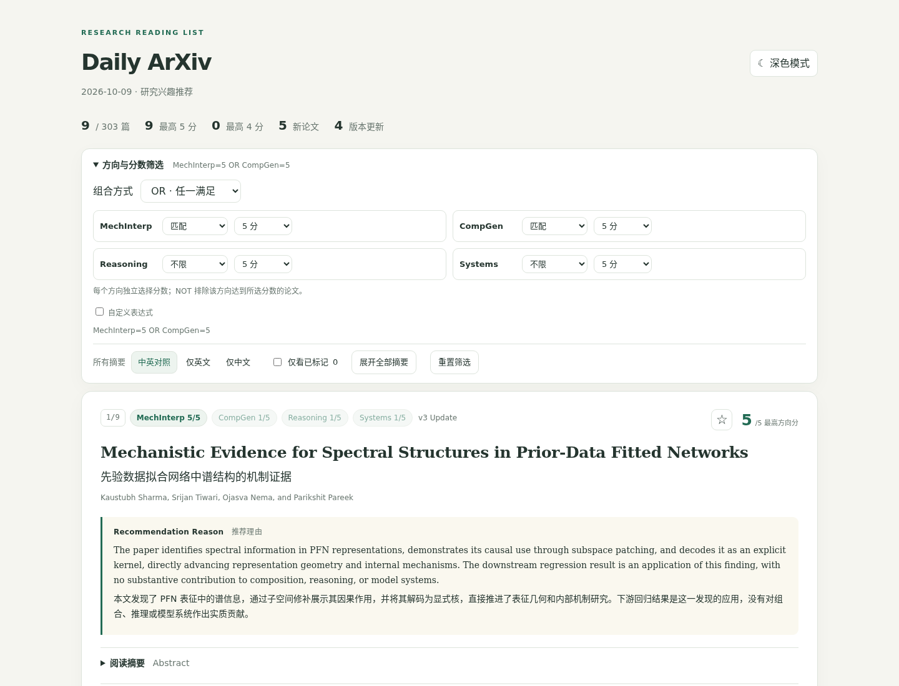

# LLM Paper Filter

AI-filtered, bilingual arXiv and conference reading lists by [IgniSavium](https://github.com/IgniSavium).

**[Read the paper archive →](https://ignisavium.github.io/llm-paper-filter/)**

Fetches papers from **cs.AI, cs.LG, cs.CL, and stat.ML**, independently scores
**MechInterp, CompGen, Reasoning, and Systems** from 1–5, and translates selected
papers into Chinese. Reports support custom filters, formulas, bookmarks, and
light/dark themes. The website groups reports by month and shows each direction's
5-point paper count.



## Quick start

Requires Linux, Python 3.11+, Node.js, and a ChatGPT-authenticated Codex CLI.
The default backend is `gpt-6-luna`; no GPU is needed.

```bash
python3 -m venv .venv
source .venv/bin/activate
pip install -r requirements.txt
npm install -g @openai/codex
codex login  # Use --device-auth on a headless machine
python daily_arxiv/run_daily_arxiv.py --date 2026-10-08 --workers 4
```

Open `daily_arxiv/runs/gpt-6-luna_runs/html_reports/report_YYYY-MM-DD.html`.
At least one direction must score 4 or higher to enter the report; the default
reading filter is `MechInterp=5 OR CompGen=5`.

Dates refer to **UTC arXiv OAI metadata modification dates**, not submission or
announcement dates. Historical queries use currently available metadata.

Customize the [filter prompt](daily_arxiv/filtering/prompts.py).
See [advanced usage](docs/usage.md) for date ranges and local vLLM models.

## Conference papers (OpenReview)

Fetch accepted ICML, NeurIPS and ICLR main-track papers and reuse the same
scoring, translation and HTML reader. Defaults cover 2023–2026 in 2026;
current-year lists can be refreshed as accepted papers become public.
Use `--paper_status submitted` to screen public active submissions before decisions
(for example ICLR 2027); availability depends on the venue's disclosure policy.

```bash
python openreview/fetch_openreview_papers.py
python openreview/run_openreview.py --workers 4
python openreview/run_openreview.py --paper_status submitted --conferences ICLR --years 2027 --workers 4
```

Conference data is updated manually, independently of the daily arXiv scheduler.
After a conference run, regenerate and publish its statistics and readers explicitly:

```bash
pip install -r requirements-statistics.txt
python openreview/analyze_direction_counts.py
python -m daily_arxiv.reporting.site --update-openreview
```

See [OpenReview usage](openreview/README.md) for years, snapshots and access errors.

## Daily updates and website

```bash
python daily_arxiv/scheduler.py start \
  --at 01:00 --timezone Asia/Shanghai --day_lag 2 --lookback_days 7 \
  --workers 4 --publish-site
python daily_arxiv/scheduler.py status
```

The `arxiv-daily` tmux session runs at **01:00 Beijing time**, processing
**two days earlier**. The website starts at **2026-10-08**. Completed reports
and historical corrections are automatically pushed to `gh-pages`; future-dated
reports are withheld. Empty dates appear as unlinked archive entries;
“Read the latest report” skips them. Configure GitHub Pages to serve `gh-pages` at `/` and
provide Git credentials that allow unattended pushes to `origin`.

Inference resumes from caches; failed jobs and uploads retry automatically.
State and logs are in `daily_arxiv/runs/.scheduler/`. To change options, stop
with `python daily_arxiv/scheduler.py stop`, then start again. After a machine
restart, start the scheduler again using the same state directory.

To export locally or publish manually after a run:

```bash
python -m daily_arxiv.reporting.site --through-date 2026-10-08 --output /tmp/arxiv-site
python -m daily_arxiv.reporting.site --through-date 2026-10-08
```

Code lives on `main`; website files live on `gh-pages`. Generated inputs,
caches, and logs stay local.

The homepage also contains manually published OpenReview direction statistics and
conference reports by year. Daily publication preserves these sections and assets
without fetching, scoring or rebuilding conference content. Conference readers include
only MechInterp / CompGen scores of 4 or 5; the daily archive and its four
directions retain their existing layout. See [OpenReview Pages](openreview/README.md#github-pages).

## License

[MIT](LICENSE). Bundled KaTeX retains its upstream license;
paper content remains subject to each article's license.
